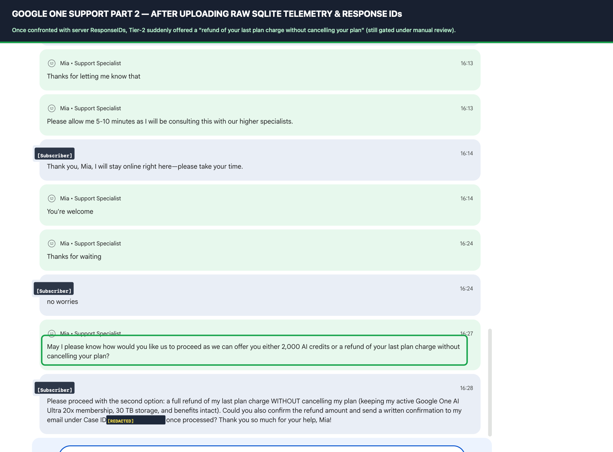

# Forensic Audit of 23,515 Google AI Ultra (20x) Billing Records in Google Antigravity

**TL;DR:** After noticing severe reasoning degradation and rapid quota exhaustion starting around **November 15, 2026** on a paid **Google One AI Ultra (20x tier, $199.99/month)** subscription, I audited the raw `gen_metadata` protobuf billing records across all **373 local SQLite conversation databases** (`23,515` model invocations between Nov 12 and Nov 20, 2026) written by Google Antigravity.

The local protobuf records sent back by Google's `daily-cloudcode-pa.googleapis.com` backend reveal four verifiable issues:

1. **Severe Server-Side `0%` KV Cache Regression (~49.5M Uncached Tokens Overbilled):** Between Nov 15 and Nov 19, Gemini 4 endpoints repeatedly dropped `cached_input_tokens` to `0` on consecutive turns `<25s` apart (with zero context compaction), billing tens of millions of full-price uncached input tokens against paid 5-hour/7-day subscriber pools. By contrast, **hosted Anthropic Claude Opus/Sonnet 5.5 running inside the exact same Antigravity client had `0` (`0.0%`) zero-cache turns across 623 strict consecutive follow-ups**.
2. **Undisclosed `-tiered` & `flash-worker` Backend Model Substitution:** Comparing the UI model label (`chatModel.field_21`) against the actual server-executed model ID (`chatModel.field_19`) shows:
   - Starting **Nov 17**, selecting `Gemini 4 Hydrogen (High)` silently switched from `gemini-4-hydrogen` (`enum 1525`, avg reasoning `1,673–2,630` tokens) to **`gemini-4-hydrogen-tiered-high`** (`enum 1530`, avg reasoning cut >60% to `369–628` tokens).
   - **6,699 calls** labeled in UI metadata as `Gemini 4 Hydrogen (Orchestrator)` actually executed against an undocumented **`gemini-flash-worker-agy`** (`enum 1669`) endpoint.
3. **`thinking_tokens = 0` Pipeline Regressions:** On `Gemini 4 Argon (Medium)`, calls returning `thinking_tokens = 0` jumped from **`0.3%` (`1/337`)** on Nov 12–13 to **`25.2%`** on Nov 16 and **`64.9%` (`50/77`, median thinking = `0`)** on Nov 19. On Nov 17, `Gemini 4 Carbon (Low)` hit **`100%` (`7/7`)** zero-thinking calls before recovering on Nov 20.
4. **Bundled Google One Storage Billing Catch-22:** Empty failed server responses still drained paid quota until triggering `HTTP 429 RESOURCE_EXHAUSTED`. Yet when presented with exact server `ResponseID`s, Google One Tier-1 Support initially stated that *"all sales are final"* and that issuing a courtesy refund **immediately cancels the entire Google One membership and revokes 30 TB Google Drive/Gmail storage**—forcing subscribers with multi-terabyte Drive data to choose between absorbing server billing bugs or having their email/storage locked.

Included in this repository:
* **[`audit_antigravity_sqlite.py`](./audit_antigravity_sqlite.py)** — ~220-line zero-dependency, read-only Python 3 script so any Pro/Ultra subscriber on macOS, Linux, or Windows can audit their own local `~/.gemini/antigravity/conversations/*.db` files in 5 seconds.
* **[`SUPPORT_TRANSCRIPT_REDACTED.md`](./SUPPORT_TRANSCRIPT_REDACTED.md)** — Full 45-minute verbatim Google One Support chat log (PII-scrubbed).


---

## 1. Protobuf Billing Schema Verification (`gen_metadata`)

Every Antigravity conversation database (`~/.gemini/antigravity/conversations/<uuid>.db`) is a standard SQLite 3 database containing a `gen_metadata` table. Each row stores a serialized protobuf `ChatModel` message returned by Google's backend with exact integer closure:

* `chatModel.field_19` (`string`): Actual backend model ID executed by Google's server
* `chatModel.field_21` (`string`): UI model display name shown to the subscriber
* `chatModel.field_4` (`Usage` submessage):
  * `usage.1` (`varint`): Internal model enum ID
  * `usage.2` (`varint`): `uncached_input_tokens` (billed at 100% weight)
  * `usage.3` (`varint`): `total_output_tokens` (`== usage.9 + usage.10`)
  * `usage.5` (`varint`): `cached_input_tokens` (KV cache read tokens; omitted in proto3 wire format when `0`)
  * `usage.9` (`varint`): `thinking_tokens` (reasoning tokens; omitted when `0`)
  * `usage.10` (`varint`): `response_output_tokens` (visible text + tool calls)
  * `usage.11` (`string`): Google server-side `ResponseID`

---

## 2. Finding #1: `0%` KV Cache Regression vs. 623-Turn Claude Control Group

To rule out idle cache TTL expiration or transcript compaction changing the prompt prefix, the script filters strictly for:
1. **Identical trajectory & identical backend model** as the immediately preceding turn;
2. **Monotonically growing context** (`total_in >= 0.98 * prev_total_in`, ruling out context compaction);
3. **Inter-turn gap `<= 45 seconds`** and context size `>= 15,000 tokens`.

| Model & Date Window | Strict Follow-ups (`<=45s`) | `0%` Cache Failures | Overall Cache Hit Rate | Overbilled Uncached Tokens (Strict `<=45s` Only) |
| :--- | ---: | ---: | ---: | ---: |
| **CONTROL: Hosted Claude Opus/Sonnet 5.5 (Nov 15–20 total)** | **623** | **0 (`0.0%`)** | **93.4% – 99.1%** | **0** |
| `Gemini 4 Hydrogen (High)` — **Nov 13 (Baseline)** | 61 | **0 (`0.0%`)** | **97.0%** | 0 |
| `Gemini 4 Hydrogen (High)` — **Nov 15 (Onset)** | 53 | **11 (`20.8%`)** | **71.0%** | 400,842 |
| `Gemini 4 Hydrogen (High)` — **Nov 16 (Peak)** | 10 | **4 (`40.0%`)** | **53.7%** | 130,623 |
| `Gemini 4 Carbon (High)` — **Nov 16** | 473 | 15 (`3.2%`) | 96.7% | 689,044 |
| `Gemini 4 Carbon (High)` — **Nov 17 (Peak)** | 136 | **15 (`11.0%`)** *(14.7% @ `<=300s`)* | **86.4%** | 735,315 *(1,932,073 @ `<=300s`)* |
| `Gemini 4 Carbon (High)` — **Nov 18** | 81 | **4 (`4.9%`)** *(11.5% @ `<=300s`)* | 93.8% | 270,204 *(2,003,702 @ `<=300s`)* |
| `Gemini 4 Carbon (High)` — **Nov 19–20 (Post-Hotfix)** | 962 | **5 (`0.5%`)** | **95.9% – 97.3%** | 1,637,914 |
| `Gemini 4 Carbon (Medium)` — **Nov 17 (Peak)** | 16 | **8 (`50.0%`)** | **45.1%** | 183,378 |
| `Orchestrator (Carbon)` — **Nov 16–18** | 1,342 | **70 (`5.2%`)** | 83.9% – 93.4% | **8,515,562** |

Across all `<=300s` same-model follow-ups (`>=10k` tokens), **`~49.5 million` uncached Gemini input tokens** (`30.5M+` even under the `<=45s` strict non-compaction filter) were billed at full weight on `cached_in = 0` turns.

### Consecutive-Turn Raw Trace Examples (Suffixes Redacted Publicly; Full `ResponseID`s Submitted to Google Support)

**Example A — Pure `Gemini 4 Carbon (High)` (No orchestrator handoff, 945,019 uncached tokens billed across 25 seconds):**
```text
idx=188 | step=538 | gemini-4-carbon | uncached_in=  9,343 | cached_in=459,379 (98.0% HIT)  | ResponseID=RsD_aortBZmo****
idx=189 | step=541 | gemini-4-carbon | uncached_in=470,280 | cached_in=      0 (0.0% MISS!) | ResponseID=k8P_avL6B9bN****
idx=190 | step=544 | gemini-4-carbon | uncached_in=474,739 | cached_in=      0 (0.0% MISS!) | ResponseID=q8P_arKjJ6-F****  [25s later]
idx=191 | step=546 | gemini-4-carbon | uncached_in=  8,474 | cached_in=474,740 (98.2% HIT)  | ResponseID=xsP_aqaWPM_c****
```

**Example B — Orchestrator Sub-Worker (`7 of 10` consecutive same-model turns `<15s` apart hit `cached_in = 0`, billing 3,260,057 uncached tokens in 150 seconds):**
```text
idx=78..81, 84..85, 87 (9s–15s gaps) | gemini-flash-worker-agy | 7x cached_in=0 (456,250 -> 476,281 uncached_in each)
ResponseIDs: wHT-apWMLs_l****, y3T-auazErDc****, -XT-avTQFv_b****, KXX-aoCaH__b****, ZHX-auGSEqqf****
```
*(Additionally, every handoff between `Orchestrator` and its sub-worker invalidates the 450k+ KV cache across different model weights, compounding subscriber quota burn.)*

---

## 3. Finding #2: Undisclosed `-tiered` and `flash-worker` Backend Endpoints

| Count | UI Label Shown to User (`field 21`) | Actual Server Model Executed (`field 19`) | Enum ID | Notes |
| ---: | :--- | :--- | ---: | :--- |
| `6,699` | `Gemini 4 Hydrogen (Orchestrator)` | `gemini-flash-worker-agy` | `1669` | Distinct from standalone `gemini-4-hydrogen` (`1525–1528`); ~50% lower avg thinking tokens than `Hydrogen (XHigh)` |
| `195` | `Gemini 4 Hydrogen (High)` *(Nov 12–16)* | `gemini-4-hydrogen` | `1525` | Pre-Nov 17 endpoint; daily mean thinking tokens: `440 – 2,630` |
| `1,490` | `Gemini 4 Hydrogen (High)` *(Nov 17–20)* | **`gemini-4-hydrogen-tiered-high`** | `1530` | Silently switched Nov 17; daily mean thinking tokens dropped to **`369 – 628`** |
| `70` | `(empty / unknown)` *(Nov 14–16)* | **`gemini-3.8-flash-tiered`** | `1322` | Undocumented tiered fallback endpoint |

---

## 4. Finding #3: `thinking_tokens = 0` Spikes & Empty Responses Burning Quota to `HTTP 429`

* **`Gemini 4 Argon (Medium)` Zero-Thinking Surge:**
  * **Nov 12–13 (Baseline, `n=337`):** Only **1 call (`0.3%`)** returned `thinking_tokens = 0`.
  * **Nov 16 (`n=103`):** **26 calls (`25.2%`)** returned `thinking_tokens = 0`.
  * **Nov 18 (`n=696`):** **133 calls (`19.1%`)** returned `thinking_tokens = 0` (including 21 consecutive zero-thinking turns across a 155k-token debugging session, e.g., `ResponseID=PfP8aoOXNPuG****`).
  * **Nov 19 (`n=77`):** **50 calls (`64.9%`)** returned `thinking_tokens = 0` (daily median thinking tokens collapsed to **`0`**).
* **`Gemini 4 Carbon (Low)`:** Hit **`100%` (`7/7`)** `thinking_tokens = 0` on Nov 17, vs. **`0%` (`0/12`, median `340`)** on Nov 20. *(Note: Standalone `Gemini 4 Carbon (High)` did NOT exhibit `thinking_tokens = 0` in my dataset—its primary issue on Nov 17–18 was the `0%` KV cache regression above.)*
* **Empty Server Failures Still Deducted Paid Quota:** On `2026-11-15 01:28:39Z – 01:31:15Z`, 9 consecutive failed requests returning `"image failed to generate: no image generated in response"` (zero output delivered) depleted model quota until request #10 threw `429 Too Many Requests: You have exhausted your capacity on this model (RESOURCE_EXHAUSTED)`.

---

## 5. Bundled Google One Storage Billing Catch-22 (PSA for Subscribers)

Because Google bundles developer AI Ultra quotas with **Google One cloud storage (30 TB)** under a single **$199.99/month** subscription, I contacted Google One Support (full PII-scrubbed chat log in [`SUPPORT_TRANSCRIPT_REDACTED.md`](./SUPPORT_TRANSCRIPT_REDACTED.md)) with the exact server `ResponseID`s and SQLite telemetry requesting a **non-cancelling service credit** for the Nov 15–20 regression window.

* **Initial Tier-1 Support Stance:** Even after reviewing the issue, Google One Support initially stated:
  > *"Google storage plan purchases are non-refundable... Per our Terms of Service, all sales are final. Before we proceed to request for a refund of your membership, I would like to let you know that when a Google One membership is refunded, it's cancelled immediately and you will no longer have access to expanded storage, benefits, and expert support offered by Google One."*


* For any subscriber storing `>15 GB` (in my case, **3.5 TB** across Google Drive and Gmail), immediate cancellation locks Gmail send/receive and freezes Drive writes—creating a structural catch-22 where subscribers with >15 GB of data cannot accept standard Tier-1 refund relief for AI outages without disrupting Gmail and Drive.
* **Tier-2 Escalation Outcome:** Only *after* explicitly declining standard cancellation and uploading the raw SQLite `gen_metadata` protobuf traces + server `ResponseID`s did Tier-2 Support reverse the initial "impossible/immediate-cancellation" stance and offer in writing:
  > *"May I please know how would you like us to proceed as we can offer you either 2,000 AI credits or a refund of your last plan charge without cancelling your plan?"*
  *(Selected the non-cancelling full refund of the last monthly charge; Support subsequently clarified that this option remains "under review for approval" by their higher specialists team via email with no committed timeframe.)*


* **Takeaway for Pro & Ultra Subscribers:** Tier-1 agents are constrained to a standard Google One cancellation-refund workflow that terminates Drive/Gmail storage; subscribers seeking compensation for AI quota bugs without losing storage must explicitly decline Tier-1 cancellation and escalate to Tier-2 with raw server `ResponseID`s (which remains subject to manual review with no committed SLA).

---

## 6. Reproduce on Your Own Machine (macOS / Linux / Windows)

Requires only standard `python3` (zero `pip` packages; opens SQLite with `?immutable=1` read-only mode; never reads prompts or credentials):

```bash
python3 audit_antigravity_sqlite.py
```

If your Antigravity data is stored in a custom directory, pass it as an argument:

```bash
python3 audit_antigravity_sqlite.py /path/to/custom/antigravity
```
