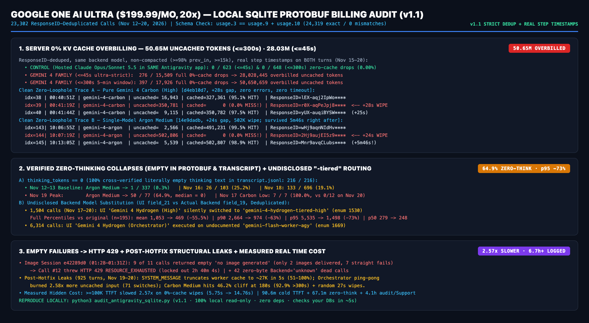
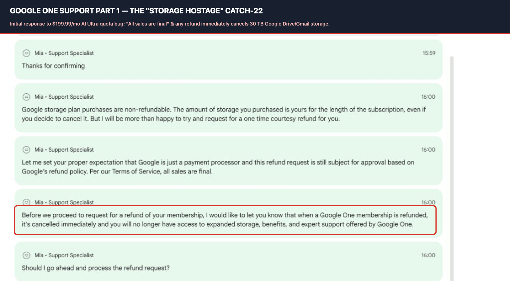

# Forensic Audit of 23,302 Unique Google AI Ultra (20x) Billing Records in Google Antigravity

> **v1.1 Independent Re-Audit & Hardening Update (Nov 21, 2026):**
> Following a self-imposed adversarial code & data audit before publishing a companion breakdown, `audit_antigravity_sqlite.py` has been upgraded to **v1.1** with:
> 1. **Strict `ResponseID` (`usage.11`) deduplication** across forked/Swarm/backup DBs (removing `791` duplicate rows from forked conversations);
> 2. **Strict real per-step timestamp gating** (excluding any row lacking real `transcript.jsonl` step timestamps from inter-turn gap math — never falling back to file `mtime`);
> 3. **Algebraic schema self-verification** (`usage.3 == usage.9 + usage.10`: **`24,319 exact / 0 mismatches`**);
> 4. **Zero-loophole trace replacement**: Replaced the earlier `41090d3c` `idx=189` row (which followed a 14m05s idle gap before `idx=190`'s genuine 25s bug) with 100% continuous `<30s` single-model wipes (`d4eb10d7` `+28s` / `350,781` uncached on `Carbon High`; `14e9dadb` `+24s` / `502,806` uncached on `Argon Medium`), refined `gemini-4-hydrogen-tiered-high` reporting to full percentiles (`mean -55.5%`, `p95 -73%`, `p50` flat), refined `e42289d0` image-429 to its exact `9/11` failures (`7` consecutive right before `HTTP 429`, `2` images delivered), added the **post-hotfix 3 structural cache leaks** + **fair Claude Code comparison** + **measured latency/time cost**, and added a note that Tier-1 Support politely sent a post-chat confirmation email stating escalation to higher specialists (still with no timeline or decision yet).
>
> **Headline result after strict v1.1 deduplication & timestamp gating:** Overbilled Gemini uncached input (`<=300s`, Nov 15–20) is **`50,650,659` tokens** (`28,028,445` even under `<=45s`); hosted Claude in the exact same Antigravity client remains **`0 / 623` (`<=45s`)** and **`0 / 648` (`<=300s`)** zero-cache failures.

---

**TL;DR:** After noticing degraded output quality and rapid quota exhaustion starting **November 15, 2026** on a paid **Google One AI Ultra (20x tier, $199.99/month)** subscription, I audited the raw `gen_metadata` protobuf billing records across all **383 local SQLite conversation databases** (`23,302` `ResponseID`-deduplicated calls between Nov 12 and Nov 20, 2026) written by Google Antigravity.

The native protobuf records returned by Google's `daily-cloudcode-pa.googleapis.com` backend reveal five verifiable issues:

1. **Server-Side `0%` KV Cache Overbilling (`50.65M` Uncached Tokens `<=300s`, `28.03M` `<=45s`):** Between Nov 15 and Nov 20, Gemini 4 endpoints repeatedly dropped `cached_input_tokens` to `0` on continuous same-model turns `<30s` apart (zero compaction, zero errors), billing tens of millions of full-price uncached input tokens against paid 5h/7d subscriber pools. By contrast, **hosted Anthropic Claude Opus/Sonnet 5.5 inside the exact same Antigravity client had `0` (`0.0%`) zero-cache turns across `623` (`<=45s`) and `648` (`<=300s`) strict follow-ups**.
2. **Undisclosed `-tiered` & `flash-worker` Backend Routing:** Comparing UI display labels (`field_21`) against actual server-executed model IDs (`field_19`):
   - Starting **Nov 17**, selecting `Gemini 4 Hydrogen (High)` silently switched from `gemini-4-hydrogen` (`enum 1525`, `n=195`) to **`gemini-4-hydrogen-tiered-high`** (`enum 1530`, `n=1,504`): mean reasoning fell **`55.5%`** (`1,053 → 469`), and high-end deep reasoning (`p95`) was cut **`73%`** (`5,535 → 1,498`), while median (`p50`) stayed flat (`279 → 248`).
   - **`6,314` deduplicated calls** labeled `Gemini 4 Hydrogen (Orchestrator)` executed on an undocumented **`gemini-flash-worker-agy`** (`enum 1669`) endpoint.
3. **Verified `thinking_tokens = 0` Collapses (Empty in Both Protobuf AND Transcript Text):** On `Gemini 4 Argon (Medium)`, `thinking_tokens = 0` spiked from **`0.3%` (`1/337`)** on Nov 12–13 to **`25.2%`** (Nov 16), **`19.1%`** (Nov 18), and **`64.9%` (`50/77`, median `0`)** on Nov 19. `Gemini 4 Carbon (Low)` hit **`100%` (`7/7`)** on Nov 17 before recovering (`0/12`, median `340`) on Nov 20. Cross-checking `transcript.jsonl` confirms **`216/216`** of these calls had literally empty `thinking` text.
4. **Empty Failures Drain Quota + Three Post-Hotfix Structural Cache Leaks:** In session `e42289d0`, **`9` of `11`** image-generation requests returned `"image failed to generate: no image generated in response"` (only 2 images delivered, ending in **7 consecutive empty failures**) before attempt #12 hit `HTTP 429 RESOURCE_EXHAUSTED` (`2h40m4s` lockout). Even after the mid-November hotfix (`925` turns across Nov 19–20), three structural leaks persist: async `SYSTEM_MESSAGE` wakeups truncate `flash-worker` cache back to `~25K–27K` within `5s` (`51.1%–100%`); `Orchestrator (Neon)` model ping-pong (`71` switches) burned **`2.58×`** more uncached input than running `Carbon Medium` straight; and `Carbon Medium` still suffers random `27s` wipes plus a **`46.2%` eviction cliff at `180s` (`92.9%` `>300s`)**.
5. **Bundled Google One 30 TB Refund Catch-22 & Hidden Time Cost:** Because AI Ultra is bundled with 30 TB Google Drive storage, Tier-1 Support's policy states that a standard refund immediately cancels the Google One membership and storage (blocking anyone storing >15 GB — here 3.5 TB + primary Gmail). Only after uploading raw SQLite traces and server `ResponseID`s did Tier-2 offer a non-cancelling refund option, which remains pending higher-specialist approval with no timeline. Measured server wait (`>=100K` TTFT `2.57×` slower on cold wipes: `5.75s → 14.76s`), degraded turns, and forced forensic/support time totaled **`6.7+` directly logged hours (`9.4h` with lockout)** — easily a full workday once human rework is included.

Included in this repository:
* **[`audit_antigravity_sqlite.py`](./audit_antigravity_sqlite.py)** (`v1.1`) — Zero-dependency, read-only Python 3 script (`?immutable=1`, zero network calls, never reads prompts/credentials, strict `ResponseID` dedup + real step-timestamp gating) for macOS, Linux, and Windows.
* **[`SUPPORT_TRANSCRIPT_REDACTED.md`](./SUPPORT_TRANSCRIPT_REDACTED.md)** — Full 43-minute verbatim Google One Support chat log (PII-scrubbed) + post-chat escalation email note.



---

## 1. Protobuf Billing Schema Verification (`gen_metadata`)

Every Antigravity conversation database (`~/.gemini/antigravity/conversations/<uuid>.db`) is a standard SQLite 3 database containing a `gen_metadata` table storing serialized `ChatModel` protobuf messages returned by Google's backend.

Across **`24,319` non-zero calls**, the integer identity **`usage.3 (total_output_tokens) == usage.9 (thinking_tokens) + usage.10 (response_output_tokens)`** holds with **`0` mismatches (`100.000%` exact closure)**:

* `chatModel.field_19` (`string`): Actual backend model ID executed by Google's server
* `chatModel.field_21` (`string`): UI model display name shown to the subscriber
* `chatModel.field_11` / `field_12` (`google.protobuf.Duration`): Server TTFT / prefill wait (`d11`) and stream duration (`d12`)
* `chatModel.field_4` (`Usage` submessage):
  * `usage.1` (`varint`): Internal model enum ID
  * `usage.2` (`varint`): `uncached_input_tokens` (full weight)
  * `usage.3` (`varint`): `total_output_tokens` (`== usage.9 + usage.10`)
  * `usage.5` (`varint`): `cached_input_tokens` (KV cache read tokens; omitted in proto3 when `0`)
  * `usage.9` (`varint`): `thinking_tokens` (reasoning tokens; omitted when `0`)
  * `usage.10` (`varint`): `response_output_tokens` (visible text + tool calls)
  * `usage.11` (`string`): Google server-side `ResponseID`

---

## 2. Finding #1: `0%` KV Cache Overbilling vs. Hosted Claude Control Group (v1.1 Strict)

To eliminate idle TTL expiration, context compaction, forked-DB duplicates, or missing timestamps, `audit_antigravity_sqlite.py v1.1` enforces all five filters simultaneously:
1. **Unique `ResponseID` (`usage.11`)** across all scanned databases;
2. **Real per-step `transcript.jsonl` timestamps on BOTH previous and current turns** (never file `mtime`);
3. **Identical trajectory & identical backend model (`field_19`)** as the immediately preceding turn;
4. **Monotonically growing context** (`total_in >= 0.98 * prev_total_in`, ruling out compaction);
5. **Context size `>= 15,000 tokens`** within `<= 45s` (ultra-strict) or `<= 300s` (5-min session window).

### Summary (Nov 15–20, 2026 — Reproducible via `python3 audit_antigravity_sqlite.py --since 2026-11-15 --until 2026-11-20`)

| Cohort & Window | Strict Follow-up Turns | `0%` Cache Drops (`cached_in = 0`) | Overbilled Uncached Tokens |
| :--- | ---: | ---: | ---: |
| **CONTROL: Hosted Claude Opus/Sonnet 5.5 (`<= 45s`)** | **623** | **0 (`0.00%`)** | **0** |
| **CONTROL: Hosted Claude Opus/Sonnet 5.5 (`<= 300s`)** | **648** | **0 (`0.00%`)** | **0** |
| **Gemini 4 Family (`<= 45s`, ultra-strict)** | **15,509** | **276 (`1.78%`)** | **28,028,445** |
| **Gemini 4 Family (`<= 300s`, 5-min window)** | **17,926** | **397 (`2.21%`)** | **50,650,659** |

*(Full 9-day Nov 12–20 window `<= 300s`: `20,811` Gemini turns, `442` zero-cache drops, `54,180,009` overbilled uncached tokens; Claude `0 / 648`.)*

### Clean Zero-Loophole Raw Trace Examples (Zero Errors, Zero `SYSTEM_MESSAGE`, Zero Timeout, `<30s` Gaps)

**Trace A — Pure `Gemini 4 Carbon (High)` (`d4eb10d7`, `+28s` gap, `350,781` full-price wipe mid-loop):**
```text
idx=38 | step=122 | 2026-11-19T00:40:51Z | gemini-4-carbon | uncached= 16,943 | cached=327,361 (95.1% HIT)  | ResponseID=lEX-aqj2IpWo****
idx=39 | step=125 | 2026-11-19T00:41:19Z | gemini-4-carbon | uncached=350,781 | cached=      0 (0.0% MISS!) | ResponseID=r0X-aqPeJpj8****  [+28s]
idx=40 | step=128 | 2026-11-19T00:41:44Z | gemini-4-carbon | uncached=  9,115 | cached=350,782 (97.5% HIT)  | ResponseID=yUX-auqiBYSW****  [+25s]
```

**Trace B — Single-Model `Gemini 4 Argon (Medium)` (`14e9dadb`, `+24s` gap, `502,806` full-price wipe; prefix survived `5m46s` right after):**
```text
idx=143 | step=404 | 2026-11-18T10:06:55Z | gemini-4-argon | uncached=  2,566 | cached=491,231 (99.5% HIT)  | ResponseID=wHj9aqnNIdHv****
idx=144 | step=408 | 2026-11-18T10:07:19Z | gemini-4-argon | uncached=502,806 | cached=      0 (0.0% MISS!) | ResponseID=2Hj9aujEI5z9****  [+24s]
idx=145 | step=412 | 2026-11-18T10:13:05Z | gemini-4-argon | uncached=  5,539 | cached=502,807 (98.9% HIT)  | ResponseID=Mnr9avqCLubs****  [+5m46s]
```

**Trace C — Post-Hotfix Single-Model `Gemini 4 Carbon (Medium)` (`611de086`, `+27s` gap, `325,737` full-price wipe):**
```text
idx=419 | step=1059 | 2026-11-20T17:10:32Z | gemini-4-carbon | uncached=  2,307 | cached=323,074 (99.3% HIT)  | ResponseID=GX8Aa6eEH9my****
idx=420 | step=1061 | 2026-11-20T17:10:59Z | gemini-4-carbon | uncached=325,737 | cached=      0 (0.0% MISS!) | ResponseID=NH8Aa8ixHM-Z****  [+27s]
idx=421 | step=1063 | 2026-11-20T17:11:38Z | gemini-4-carbon | uncached=  2,499 | cached=323,688 (99.2% HIT)  | ResponseID=V38Aa6TPL5f6****  [+39s]
```

---

## 3. Finding #2: Undisclosed `-tiered` and `flash-worker` Backend Endpoints (Deduplicated)

| Unique Calls (Nov 12–20) | UI Label (`field 21`) | Actual Backend Model (`field 19`) | Enum | Thinking Distribution (`p50` / `mean` / `p90` / `p95`) |
| ---: | :--- | :--- | ---: | :--- |
| `195` | `Gemini 4 Hydrogen (High)` *(Nov 12–16, 19)* | `gemini-4-hydrogen` | `1525` | `p50=279` / `mean=1,053` / `p90=2,664` / **`p95=5,535`** |
| `1,504` | `Gemini 4 Hydrogen (High)` *(Nov 17–20)* | **`gemini-4-hydrogen-tiered-high`** | `1530` | `p50=248` / **`mean=469 (-55.5%)`** / `p90=974 (-63%)` / **`p95=1,498 (-73%)`** |
| `6,314` | `Gemini 4 Hydrogen (Orchestrator)` | **`gemini-flash-worker-agy`** | `1669` | Undocumented internal worker endpoint |
| `70` | `(empty / unknown)` *(Nov 14–16)* | **`gemini-3.8-flash-tiered`** | `1322` | Undocumented tiered fallback endpoint |

---

## 4. Finding #3: Verified `thinking_tokens = 0` Collapses & Empty Failures Burning Quota

* **`Gemini 4 Argon (Medium)` Zero-Thinking Surge (`usage.9 == 0`, 100% cross-verified empty in `transcript.jsonl` `thinking` text):**
  * **Nov 12–13 (Baseline, `n=337`):** `1` call (`0.3%`)
  * **Nov 16 (`n=103`):** `26` calls (`25.2%`) — `26/26` empty in transcript
  * **Nov 18 (`n=696`):** `133` calls (`19.1%`) — `133/133` empty in transcript (including 21 consecutive zero-thinking turns across a 155k-token debugging session, e.g., `ResponseID=PfP8aoOXNPuG****`)
  * **Nov 19 (Peak, `n=77`):** **`50` calls (`64.9%`, daily median = `0`)** — `50/50` empty in transcript
* **`Gemini 4 Carbon (Low)`:** Hit **`100%` (`7/7`)** zero-thinking on Nov 17 (`7/7` empty in transcript), vs. **`0%` (`0/12`, median `340`)** on Nov 20. *(Precision note: Standalone `Gemini 4 Carbon (High)` had `0/2,380` zero-thinking calls — its issue was KV cache overbilling.)*
* **Empty Image-Generation Failures Triggered `HTTP 429` (`e42289d0`, `2026-11-15 01:28:25–01:31:15 UTC`):** Across `11` image requests, `9` returned `"image failed to generate: no image generated in response"` (only 2 images delivered, ending in **7 consecutive empty failures**), and attempt #12 immediately threw `429 Too Many Requests: You have exhausted your capacity on this model. Your quota will reset after 2h40m4s (RESOURCE_EXHAUSTED)`.

---

## 5. Finding #4: Post-Hotfix Structural Cache Leaks & Fair Claude Comparison (Nov 19–20, 925 Turns)

Even after the mid-November hotfix (`Session A 611de086`: 439 turns, `9.07M` uncached; `Session B 80ccfd72`: 486 turns, `23.40M` uncached):
1. **Client Harness Bug (`SYSTEM_MESSAGE` Truncation):** Async task/subagent `SYSTEM_MESSAGE` wakeups drop `gemini-flash-worker-agy` cached prefix back to `~25K–27K` within `5s–84s` (`23/45 = 51.1%` in Session B; `3/3 = 100%` in Session A, including a `420,939 → 27,311` drop).
2. **`Orchestrator (Neon)` Model Ping-Pong (`2.58×` Uncached Penalty):** `71` planner/worker switches caused `51` major cache drops (`15.27M` tokens, `65.3%` of Session B's uncached input); returning to the planner after `>300s` missed cache **`90.3%` (`28/31`)**, making the "efficient" Orchestrator burn **`2.58×`** more uncached tokens than running flagship `Carbon Medium` straight.
3. **Server-Side `180s` Eviction Cliff:** Continuous single-model `Carbon Medium` stayed `<3%` miss under `180s`, then jumped to **`46.2%` (`6/13`)** at `180–240s` and **`92.9%` (`13/14`)** past `300s`, alongside random `27s–73s` full resets.
4. **Objective Claude Code Comparison:** Across `477` native Claude Code requests on the same Mac, overall cache read hit **`98.4%`** with **`0 / 460`** full resets inside 5 minutes (explicit contract 5-min TTL vs. Google's best-effort implicit pool). To be fair, Claude is not magic either: past 5 minutes it misses `100%`, charges a `1.25×` cache-write surcharge, and client prefix mutations can still invalidate its cache. The core problem is that Google hides per-turn cache wipes inside a black-box UI while draining paid subscriptions.

---

## 6. Bundled Google One 30 TB Policy Catch-22 & Real Total Cost

Because Google bundles developer AI Ultra compute with **Google One 30 TB storage** under one **$199.99/month** plan, requesting a refund in Google One Support triggers a structural catch-22 (full redacted chat in [`SUPPORT_TRANSCRIPT_REDACTED.md`](./SUPPORT_TRANSCRIPT_REDACTED.md)):

* **Frontline Policy Trap (Polite Agent, Broken Bundling):** The frontline agent was polite and reading standard policy: *"Per our Terms of Service, all sales are final... when a Google One membership is refunded, it's cancelled immediately and you will no longer have access to expanded storage, benefits, and expert support."* For anyone storing `>15 GB` (here **3.5 TB** + primary Gmail), standard refund relief immediately threatens Gmail and Drive.
* **Tier-2 Reversal Only After Forensic Protobufs:** After explicitly declining cancellation and uploading raw SQLite traces + server `ResponseID`s, Tier-2 offered *"either 2,000 AI credits or a refund of your last plan charge without cancelling your plan."* Selecting the non-cancelling refund triggered a polite post-chat confirmation email stating the case was escalated to higher specialists for approval — still with **no committed timeline and no decision yet**.




* **Measured Hidden Time & Energy Cost (Why Sticker Price ≠ Real Cost):**
  * On `>=100K` contexts, `0%`-cache wipes slowed median TTFT (`d11`) **`2.57×`** (`5.75s` warm across `13,378` turns vs. **`14.76s`** cold across `169` turns) — **`90.6 minutes` (`~1.5h`)** of TTFT waiting (`153.1 min` total turn wait) across `397` wipes (`<=300s`, Nov 15–20).
  * `209` degraded zero-thinking turns added **`67.1 minutes` (`~1.1h`)** of direct waiting (before human rework).
  * `e42289d0` imposed a **`2h 40m`** lockout; decoding DBs, redacting evidence, and fighting Support took **`4.1 hours`** of directly logged active work (`246 min`).
  * **Directly logged by timestamps: `~6.7h` active (`9.4h` with lockout) — easily a full workday (`10+ hours`) once human rework and storage-cancellation anxiety are counted.**

---

## 7. Reproduce on Your Own Machine (macOS / Linux / Windows)

Standard Python 3 only — zero dependencies, `?immutable=1` read-only mode, zero network calls, never reads prompts or credentials:

```bash
python3 audit_antigravity_sqlite.py
# Optional date window filter:
python3 audit_antigravity_sqlite.py --since 2026-11-15 --until 2026-11-20
# Optional custom directory:
python3 audit_antigravity_sqlite.py /path/to/custom/antigravity
```
